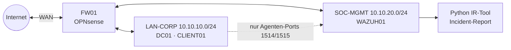

# SOC-Homelab

Laborumgebung für Security Monitoring auf Basis von VirtualBox. Das Projekt umfasst ein segmentiertes Unternehmensnetz mit Domain Controller und Client, zentrale Log-Auswertung mit Wazuh, eigene Erkennungsregeln mit MITRE-ATT&CK-Zuordnung sowie ein Python-Tool, das aus den Alarmen einen Incident-Report in Anlehnung an NIST SP 800-61 erstellt.



---

## Komponenten

| System | Technik | Aufgabe |
|---|---|---|
| FW01 | OPNsense 26.7 | Gateway, Netzsegmentierung, Default Deny, geloggte Regeln |
| DC01 | Windows Server 2025 | Active Directory `soclab.internal`, DNS, DHCP, Audit-GPO |
| CLIENT01 | Windows 11 Enterprise LTSC | Domänen-Arbeitsplatz; Agent + Sysmon per Verteilungsskript |
| WAZUH01 | Ubuntu 24.04 · Wazuh 4.14.9 | SIEM: Manager, Indexer, Dashboard |
| wazuh_ir | Python 3.13 · pandas · matplotlib | Alarm-Auswertung und Incident-Report |

## Umfang

- Anlage der VMs, AD-Struktur, Benutzer, Admin-Konto sowie Verteilung von Wazuh-Agent und Sysmon erfolgen über Skripte, die mehrfach ausgeführt werden können.
- Das SIEM befindet sich in einem eigenen Netzsegment. Clients aus dem LAN erreichen ausschließlich die Agenten-Ports.
- Advanced Audit Policy per GPO einschließlich Protokollierung der Kommandozeile, ergänzt durch Sysmon mit der Konfiguration von SwiftOnSecurity.
- 13 eigene Wazuh-Regeln, u. a. für Brute-Force, Password Spraying, Kerberoasting, kodierte PowerShell, Änderungen an privilegierten Gruppen und das Löschen von Logs.
- Python-Tool zur Abfrage und Auswertung der Alarme aus dem Wazuh-Indexer mit Ausgabe als Markdown-Report inklusive Diagrammen. 28 Tests mit synthetischen Daten, die ohne laufendes Lab ausführbar sind.
- Keine Zugangsdaten in Skripten oder im Repository, getrennte Admin-Konten.
- Dokumentation der beim Aufbau aufgetretenen Probleme samt Ursache und Lösung.

## Dokumentation

| Dokument | Inhalt |
|---|---|
| [Architektur](docs/ARCHITEKTUR.md) | Netze, Server, Firewall-Regelwerk, AD-Aufbau, Log-Datenfluss, Sicherheitsprinzipien |
| [Probleme & Lösungen](docs/PROBLEME-UND-LOESUNGEN.md) | Probleme beim Aufbau, Ursache und Lösung |
| [IR-Tool](ir-tool/README.md) | Installation, Verwendung und Aufbau des Python-Tools |
| [Erkennungsregeln](wazuh/rules/soclab_rules.xml) | eigene Wazuh-Regeln mit ATT&CK-Mapping |

## Repository

```
soc-homelab/
├── docs/                 Architektur (inkl. Diagramme), Fehlerbericht
├── scripts/
│   ├── powershell/       00 VMs · 01 AD-Struktur · 02 Benutzer · 03 Admin-Konto · 04 Agent + Sysmon
│   └── bash/             systemd-Timeout-Fix für Wazuh
├── wazuh/rules/          eigene Erkennungsregeln
└── ir-tool/              Python Incident-Response-Tool mit Tests
```

## Schnellstart

```powershell
# 1. VMs anlegen (Host, VirtualBox)
.\scripts\powershell\00-create-vms.ps1

# 2. Nach AD-Installation auf DC01: Struktur, Benutzer, Admin-Konto
.\scripts\powershell\01-ad-structure.ps1
.\scripts\powershell\02-ad-users.ps1        # Passwort wird verdeckt abgefragt
.\scripts\powershell\03-ad-admin.ps1

# 3. Wazuh-Agent + Sysmon auf jedem Windows-System
powershell -ExecutionPolicy Bypass -File \\soclab.internal\NETLOGON\Install-SOCAgent.ps1
```

```bash
# 4. WAZUH01: Start-Timeout-Fix und eigene Regeln
sudo bash scripts/bash/wazuh-timeout-fix.sh
sudo cp wazuh/rules/soclab_rules.xml /var/ossec/etc/rules/
sudo /var/ossec/bin/wazuh-analysisd -t && sudo systemctl restart wazuh-manager

# 5. Incident-Report erstellen
cd ir-tool && pip install -r requirements.txt
python -m wazuh_ir --hours 24
```

## Verwendete Technologien

VirtualBox · OPNsense/pf · Windows Server 2025 (AD DS, DNS, DHCP, GPO) · Windows 11 LTSC · Ubuntu Server 24.04 · Wazuh 4.14 (OpenSearch) · Sysmon · PowerShell · Bash · systemd · Python (requests, pandas, matplotlib, pytest) · Git · MITRE ATT&CK · NIST SP 800-61
