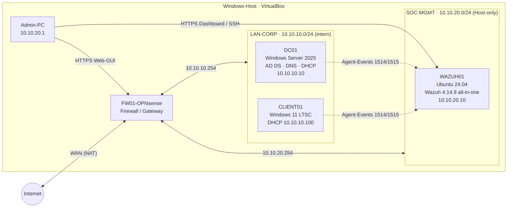
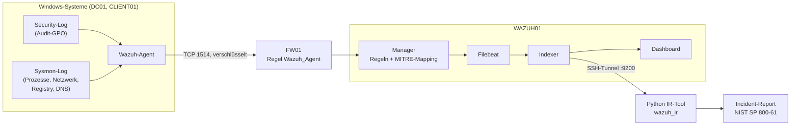

# Architektur

Dieses Dokument beschreibt den Aufbau des Labs: Netze, Server, Firewall-Regelwerk, Datenfluss der Logs und die angewendeten Sicherheitsprinzipien. Den chronologischen Aufbau und die Fehlersuche beschreibt [`PROBLEME-UND-LOESUNGEN.md`](PROBLEME-UND-LOESUNGEN.md).

---

## 1. Ziel des Projekts

Ich wollte die Arbeit in einem SOC praktisch nachvollziehen und habe dafür eine kleine Unternehmensumgebung aufgebaut, überwacht und selbst angegriffen:

1. **Aufbauen:** segmentiertes Netz mit Firewall, Domain Controller und Client.
2. **Überwachen:** zentrale Log-Sammlung und Erkennung mit einem SIEM (Wazuh) und Sysmon.
3. **Angreifen & Erkennen:** typische Angriffstechniken simulieren und im SIEM nach MITRE ATT&CK nachweisen.
4. **Reagieren:** Python-Tool, das Alarme aus dem Wazuh-Indexer abfragt und daraus einen Incident-Report nach NIST SP 800-61 erstellt.

Wiederholbare Schritte sind als Skripte im Repository abgelegt.

---

## 2. Gesamtübersicht



---

## 3. Host und Virtualisierung

| Komponente | Details |
|---|---|
| CPU | AMD Ryzen 5 1600 (6 Kerne / 12 Threads), SVM aktiviert |
| RAM | 16 GB |
| Lab-Speicher | externe 1-TB-Festplatte (NTFS) für ISOs, VMs und Repository |
| Hypervisor | Oracle VirtualBox, Steuerung überwiegend per `VBoxManage` (CLI) |
| Reproduzierbarkeit | VM-Anlage per Skript [`scripts/powershell/00-create-vms.ps1`](../scripts/powershell/00-create-vms.ps1) |

Alle Installationsabbilder wurden vor der Nutzung per SHA256 gegen die offiziellen Prüfsummen geprüft.

---

## 4. Netzwerke

| Netz | Bereich | VirtualBox-Modus | Zweck |
|---|---|---|---|
| WAN | 10.0.2.0/24 | NAT | Internetzugang der Firewall |
| **LAN-CORP** | 10.10.10.0/24 | Internes Netzwerk | Unternehmensnetz (Server + Clients) |
| **SOC-MGMT** | 10.10.20.0/24 | Host-only (DHCP aus) | Überwachung und Administration, vom LAN getrennt |

**Adresskonzept LAN-CORP:** `.1–.99` feste IPs (Server) · `.100–.200` DHCP · `.201–.253` Reserve · `.254` Gateway (Firewall).

**Begründung der Trennung:** Wird ein Client im LAN kompromittiert, darf der Angreifer weder das SIEM erreichen noch Logs manipulieren können. Clients erreichen deshalb ausschließlich die Agenten-Ports des SIEM.

---

## 5. Server und Clients

| VM | Betriebssystem | Rolle | RAM / CPU / Disk | IP |
|---|---|---|---|---|
| **FW01-OPNsense** | OPNsense 26.7 (FreeBSD) | Firewall, Gateway, Segmentierung | 1 GB / 1 / 20 GB | WAN DHCP · LAN 10.10.10.254 · SOC 10.10.20.254 |
| **DC01** | Windows Server 2025 Standard | Active Directory, DNS, DHCP | 2,5 GB / 2 / 60 GB | 10.10.10.10 (fest) |
| **CLIENT01** | Windows 11 Enterprise LTSC | Arbeitsplatz, Domänenmitglied, Testsystem für Erkennungsregeln | 3 GB / 2 / 64 GB | 10.10.10.100 (DHCP) |
| **WAZUH01** | Ubuntu Server 24.04 LTS | SIEM (Manager, Indexer, Dashboard) | 4 GB / 2 / 60 GB (LVM) | 10.10.20.10 (fest) |

### 5.1 FW01 – OPNsense

- Drei Interfaces: `em0` WAN · `em1` LAN · `em2` OPT1 (SOC).
- Default Deny auf allen internen Interfaces, erlaubt ist nur, was explizit freigegeben wurde.
- Web-GUI nur per HTTPS und nur vom Admin-PC erreichbar.
- Alle eigenen Regeln loggen, damit die Verbindungen später ausgewertet werden können.

### 5.2 DC01 – Active Directory

| Bereich | Umsetzung |
|---|---|
| Domäne | `soclab.internal` · NetBIOS `SOCLAB` · Funktionsebene Windows Server 2025 |
| DNS | AD-integriert, Forward- und Reverse-Zone (`10.10.10.in-addr.arpa`) |
| DHCP | in AD autorisiert (Schutz vor Rogue-DHCP), Scope .100–.200, Optionen Router/DNS/Domäne |
| OU-Struktur | `SOCLAB` → Users (IT, HR, Finance, Sales), Computers, Servers, Groups, Admins, ServiceAccounts |
| Benutzer | 8 fiktive Mitarbeiter in Abteilungs-OUs und -Gruppen (`GG_IT`, `GG_HR`, `GG_Finance`, `GG_Sales`) |
| Admin-Modell | getrenntes Admin-Konto (`adm.<name>`) – Tiering-Prinzip |
| Passwortrichtlinie | min. 12 Zeichen, Komplexität, Historie 12, max. 90 Tage, Sperre nach 10 Fehlversuchen für 15 min |
| Audit-GPO | `SOCLAB-Audit-Policy` (Advanced Audit Policy, siehe unten) |

Erstellt mit idempotenten Skripten:
[`01-ad-structure.ps1`](../scripts/powershell/01-ad-structure.ps1) ·
[`02-ad-users.ps1`](../scripts/powershell/02-ad-users.ps1) ·
[`03-ad-admin.ps1`](../scripts/powershell/03-ad-admin.ps1)
– Passwörter werden ausschließlich interaktiv als `SecureString` abgefragt und stehen nie im Code.

**Audit-Policy (Auszug):**

| Unterkategorie | Event-IDs | Wofür im SOC |
|---|---|---|
| Logon | 4624, 4625 | Brute-Force, ungewöhnliche Anmeldungen |
| Credential Validation | 4776 | NTLM-Anmeldungen |
| Kerberos Authentication / Service Tickets | 4768, 4769, 4771 | Kerberoasting, Password Spraying |
| User Account / Security Group Management | 4720, 4728, 4732, 4738, 4740 | neue Konten, Rechteausweitung, Sperren |
| Special Logon | 4672 | Admin-Anmeldungen |
| Process Creation (+ Kommandozeile) | 4688 | verdächtige Prozesse und Befehle |
| Audit Policy Change | 4719 | Angreifer schaltet Protokollierung ab |

### 5.3 CLIENT01

- Windows 11 Enterprise LTSC, Mitglied der Domäne, Computerkonto in `OU=Computers,OU=SOCLAB`.
- IP-Konfiguration vollständig per DHCP von DC01.
- Testsystem zur Überprüfung der Erkennungsregeln (keine zusätzliche VM nötig).

### 5.4 WAZUH01 – SIEM

| Komponente | Aufgabe | Port |
|---|---|---|
| Wazuh Manager | empfängt Events, wendet Regeln an, erzeugt Alarme | 1514 (Events), 1515 (Registrierung) |
| Wazuh Indexer | Speicherung und Suche (OpenSearch-basiert) | 9200 (lokal) |
| Filebeat | Transport Manager → Indexer | – |
| Wazuh Dashboard | Weboberfläche für Analysten | 443 |
| Wazuh API | Verwaltung (Agenten, Regeln) | 55000 |

Das Python-Tool liest Alarme direkt aus dem Indexer (`wazuh-alerts-*`). Da der Indexer nur lokal lauscht, erfolgt der Zugriff vom Admin-PC über einen SSH-Tunnel, ohne zusätzliche Firewall-Freigabe.

- Ubuntu mit LVM (Volume auf volle Größe erweitert), statischer IP, SSH, vollständig gepatcht.
- Standard-Passwort des Dashboard-Admins sofort ersetzt.
- systemd-Drop-ins mit `TimeoutStartSec=600` für Indexer und Manager (siehe [Probleme & Lösungen](PROBLEME-UND-LOESUNGEN.md)).

---

## 6. Firewall-Regelwerk

Alle Regeln sind geloggt. Die Reihenfolge ist relevant, da OPNsense nach dem First-Match-Prinzip arbeitet.

| Interface | Quelle | Ziel | Port / Protokoll | Zweck |
|---|---|---|---|---|
| LAN | LAN net | **nicht** SOC-Netz (`! OPT1 net`) | any | LAN darf ins Internet, aber nicht ins SOC-Netz |
| LAN | LAN net | 10.10.20.10 | Alias `Wazuh_Agent` (TCP 1514, 1515) | Agenten → SIEM, sonst nichts |
| OPT1 | 10.10.20.1/32 | Firewall | TCP 443 | Admin-PC → Web-GUI |
| OPT1 | 10.10.20.10/32 | 10.10.10.10 | TCP/UDP 53 | SIEM → DNS auf DC01 |
| OPT1 | 10.10.20.10/32 | **nicht** LAN net | TCP 80, 443 | SIEM → Internet (Updates, Feeds) |
| alle | – | – | – | alles andere: Default Deny |

**Getestet:** LAN → Internet erlaubt, LAN → SIEM-Agentenports erlaubt, LAN → SIEM-Dashboard/SSH/API blockiert, SIEM → LAN (außer DNS) blockiert.

---

## 7. Datenfluss der Logs



Sysmon (v15.22, Konfiguration von SwiftOnSecurity) liefert zusätzlich zu den Windows-Logs:

| Sysmon-Event | Inhalt |
|---|---|
| 1 | Prozessstart mit Kommandozeile, Hash, Elternprozess |
| 3 | Netzwerkverbindung |
| 11 | Datei erstellt |
| 13 | Registry-Wert geändert |
| 22 | DNS-Abfrage |

Die Anbindung erfolgt über einen `<localfile>`-Block (`eventchannel`) in der Agenten-Konfiguration. Die Verteilung auf weitere Clients erfolgt über ein Skript in der Freigabe `NETLOGON`, ohne Zugangsdaten im Skript.

Schon beim normalen Administrieren hat das SIEM eine Reihe von ATT&CK-Techniken gemeldet, weil Downloads, PowerShell oder neue Dienste technisch wie Angreiferverhalten aussehen:
T1078 Valid Accounts · T1110.001 Password Guessing · T1548.003 Sudo · T1136 Create Account · T1105 Ingress Tool Transfer · T1059.001 PowerShell · T1543.003 Windows Service · T1070.004 File Deletion · T1087 Account Discovery · T1484 Domain Policy Modification.

---

## 8. Sicherheitsprinzipien

| Prinzip | Umsetzung im Lab |
|---|---|
| Segmentierung | getrenntes SOC-Netz, LAN erreicht nur die Agentenports |
| Default Deny / Least Privilege | jede Firewall-Regel: eine Quelle, ein Ziel, ein Dienst |
| Defense in Depth | Netzwerk-Firewall + Windows-Firewall + Audit + SIEM |
| Getrennte Admin-Konten | Alltagskonto ohne Rechte, separates `adm.`-Konto |
| Keine Geheimnisse im Code | `Read-Host -AsSecureString`, `.gitignore` für `.env`, keine Passwörter in NETLOGON/SYSVOL |
| Integrität | SHA256-Prüfung aller Installationsabbilder, SSH-Host-Key-Fingerprint geprüft |
| Patch-Management | Ubuntu vollständig aktualisiert inkl. Kernel |
| Wiederherstellbarkeit | nummerierte VM-Snapshots nach jedem stabilen Zwischenstand |
| Nachvollziehbarkeit | jede Firewall-Regel mit Beschreibung und Logging; Infrastruktur als Skript versioniert |
| Kompromittierte Zugangsdaten | sichtbar gewordene Passwörter werden sofort ersetzt |

### Bewusste Abweichungen im Lab

Folgende Punkte weichen bewusst von einer produktiven Umgebung ab:

| Abweichung | Grund | In Produktion |
|---|---|---|
| Hardwareprüfung von Windows 11 per `LabConfig` umgangen | ältere Host-CPU, begrenzter RAM | geeignete Hardware |
| Bildschirmsperre auf DC01 deaktiviert | Bedienbarkeit im Lab | Sperre ≤ 15 min (CIS) |
| Server mit Desktop Experience | grafische Verifikation der Skripte | Server Core |
| Defender-Ausnahme für VM-Ordner (Host) | Performance auf HDD | nur mit Freigabe |
| Gemeinsame Zwischenablage Host ↔ DC01 | Komfort | in Malware-Labs deaktiviert |
| Kein IPv6 | geringere Komplexität | IPv6 bewusst absichern |
| Selbstsignierte Zertifikate | kein internes PKI | interne CA |
| Evaluation-Lizenzen | Lab | reguläre Lizenzen |

---

## 9. Repository-Struktur

```
soc-homelab/
├── README.md                    Projektübersicht
├── .gitignore                   *.iso, *.vdi, .env, __pycache__/, .venv/
├── docs/
│   ├── ARCHITEKTUR.md           dieses Dokument
│   └── PROBLEME-UND-LOESUNGEN.md Fehlerbericht
├── scripts/
│   ├── powershell/
│   │   ├── 00-create-vms.ps1        VMs per VBoxManage (idempotent)
│   │   ├── 01-ad-structure.ps1      OUs und Gruppen
│   │   ├── 02-ad-users.ps1          Benutzer
│   │   ├── 03-ad-admin.ps1          getrenntes Admin-Konto
│   │   └── 04-install-soc-agent.ps1 Wazuh-Agent + Sysmon verteilen
│   └── bash/
│       └── wazuh-timeout-fix.sh     systemd-Drop-ins
├── wazuh/rules/
│   └── soclab_rules.xml         13 eigene Erkennungsregeln mit ATT&CK-Zuordnung
└── ir-tool/                     Python Incident-Response-Tool (siehe ir-tool/README.md)
```

---

## Projektphasen

| Phase | Inhalt |
|---|---|
| 1 | Host-Setup, Downloads, Integritätsprüfung, Repository |
| 2 | Firewall, Active Directory, DHCP/DNS, Audit-GPO, Client-Domänenbeitritt |
| 3 | Wazuh-SIEM, Agenten, Sysmon, Firewall-Segmentierung |
| 4 | Eigene Erkennungsregeln (Brute-Force, Password Spraying, Kerberoasting, verschleierte PowerShell, Rechteausweitung, Log-Manipulation) |
| 5 | Python-Tool: Indexer-Abfrage, Auswertung (pandas, matplotlib), Incident-Report nach NIST, Tests (pytest) |
| 6 | Dokumentation, Diagramme, Fehlerbericht |
