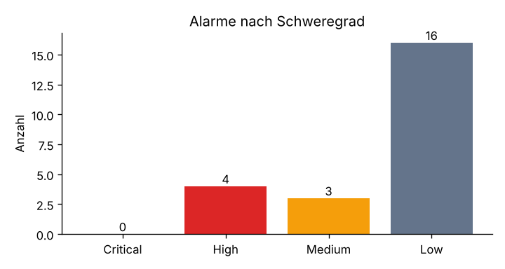
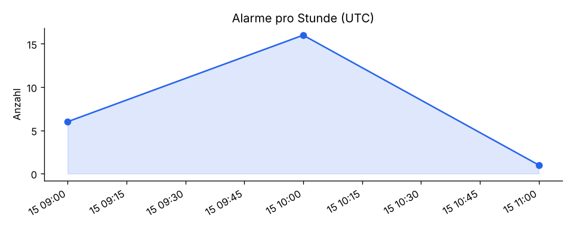
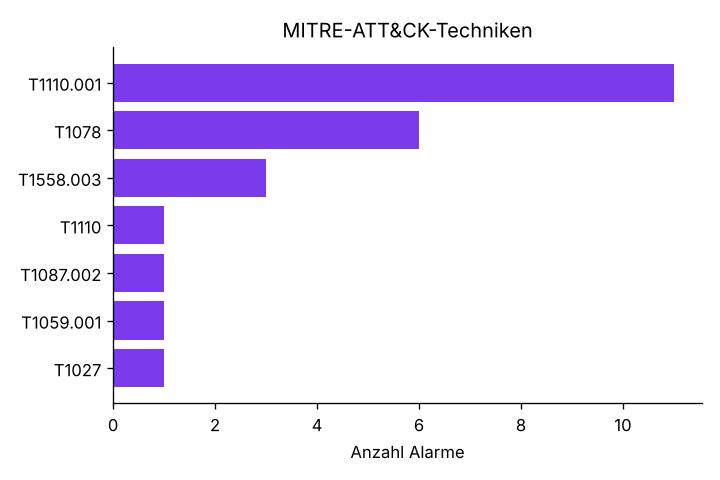

# Incident-Report IR-BEISPIEL

| Feld | Wert |
|---|---|
| Erstellt | 2026-11-03 11:45:42 UTC |
| Datenquelle | Datei sample_alerts.json |
| Betrachteter Zeitraum | 2026-01-15 09:00:00 UTC bis 2026-01-15 11:00:00 UTC |
| Höchster Schweregrad | **High** |
| Alarme gesamt | 23 |
| Betroffene Systeme | DC01, CLIENT01 |

> Struktur nach NIST SP 800-61 Rev. 2: Erkennung & Analyse → Eindämmung, Beseitigung & Wiederherstellung → Nachbereitung.

## 1. Zusammenfassung

Es wurden **23 Alarme** ausgewertet (0 Critical, 4 High, 3 Medium, 16 Low). Daraus ergeben sich **5 relevante Findings** auf 2 System(en).
Beobachtete ATT&CK-Taktiken: Credential Access, Initial Access, Discovery, Execution, Defense Evasion.

## 2. Erkennung & Analyse (Detection & Analysis)

### 2.1 Findings

| # | Schweregrad | Regel | Beschreibung | System | Anzahl | Erstmals | Zuletzt | ATT&CK | Konten | Quell-IP |
|---|---|---|---|---|---|---|---|---|---|---|
| 1 | High (12) | 100110 | SOCLAB: Mögliches Kerberoasting - RC4-Service-Ticket angefordert | DC01 | 3 | 2026-01-15 10:31:00 UTC | 2026-01-15 10:31:04 UTC | T1558.003 | lukas.gruber | 10.10.10.100 |
| 2 | High (12) | 100120 | SOCLAB: PowerShell mit kodiertem Befehl auf CLIENT01 | CLIENT01 | 1 | 2026-01-15 11:00:00 UTC | 2026-01-15 11:00:00 UTC | T1027, T1059.001 | lukas.gruber | - |
| 3 | Medium (10) | 100100 | SOCLAB: Brute-Force auf Konto anna.huber (8+ Fehlanmeldungen in 2 min) | DC01 | 1 | 2026-01-15 10:00:50 UTC | 2026-01-15 10:00:50 UTC | T1110.001 | anna.huber | 10.10.10.100 |
| 4 | Medium (8) | 100102 | SOCLAB: Konto anna.huber wurde gesperrt | DC01 | 1 | 2026-01-15 10:00:55 UTC | 2026-01-15 10:00:55 UTC | T1110 | anna.huber | - |
| 5 | Medium (7) | 100150 | SOCLAB: AD-Erkundung auf CLIENT01 | CLIENT01 | 1 | 2026-01-15 10:30:00 UTC | 2026-01-15 10:30:00 UTC | T1087.002 | lukas.gruber | - |

### 2.2 Zeitverlauf

### 2.3 MITRE ATT&CK

| Technik | Alarme |
|---|---|
| [T1110.001](https://attack.mitre.org/techniques/T1110/001/) | 11 |
| [T1078](https://attack.mitre.org/techniques/T1078/) | 6 |
| [T1558.003](https://attack.mitre.org/techniques/T1558/003/) | 3 |
| [T1110](https://attack.mitre.org/techniques/T1110/) | 1 |
| [T1087.002](https://attack.mitre.org/techniques/T1087/002/) | 1 |
| [T1059.001](https://attack.mitre.org/techniques/T1059/001/) | 1 |
| [T1027](https://attack.mitre.org/techniques/T1027/) | 1 |

### 2.4 Häufigste Regeln

| Regel | Beschreibung | Anzahl |
|---|---|---|
| 60122 | Logon failure - Unknown user or bad password | 10 |
| 60106 | Windows logon success | 6 |
| 100110 | SOCLAB: Mögliches Kerberoasting - RC4-Service-Ticket angefordert | 3 |
| 100102 | SOCLAB: Konto anna.huber wurde gesperrt | 1 |
| 100100 | SOCLAB: Brute-Force auf Konto anna.huber (8+ Fehlanmeldungen in 2 min) | 1 |
| 100150 | SOCLAB: AD-Erkundung auf CLIENT01 | 1 |
| 100120 | SOCLAB: PowerShell mit kodiertem Befehl auf CLIENT01 | 1 |

## 3. Eindämmung, Beseitigung & Wiederherstellung

Empfohlene Maßnahmen (abgeleitet aus den beobachteten ATT&CK-Taktiken):

- [ ] Passwörter der betroffenen Konten zurücksetzen, aktive Sitzungen beenden.
- [ ] Bei Kerberoasting: Dienstkonto-Passwörter (lang, zufällig) erneuern, AES statt RC4 erzwingen.
- [ ] Quell-IP der Fehlanmeldungen an der Firewall sperren und Herkunft prüfen.
- [ ] Betroffenes Konto sperren, Anmeldeherkunft und -zeit mit dem Benutzer verifizieren.
- [ ] Ausführendes Konto und System prüfen - Erkundung geht oft weiteren Schritten voraus.
- [ ] Betroffenes System vom Netz isolieren (Firewall-Regel bzw. Netzwerkkarte trennen).
- [ ] Prozessbaum (Sysmon Event 1) und Kommandozeile sichern und auswerten.
- [ ] Audit-Richtlinie und Sysmon-Status wiederherstellen, Integrität der Logs prüfen.
- [ ] Zeitraum ohne Protokollierung als blinden Fleck dokumentieren.

## 4. Nachbereitung (Post-Incident Activity)

- [ ] Ursache (Root Cause) und Einfallsweg dokumentiert
- [ ] Erkennungsregeln angepasst (zu spät / gar nicht erkannte Schritte)
- [ ] Härtungsmaßnahmen umgesetzt und im Change-Log erfasst
- [ ] Lessons Learned mit dem Team besprochen

---
*Automatisch erstellt mit `wazuh_ir`. Bewertung und Maßnahmen sind durch einen Analysten zu bestätigen.*
